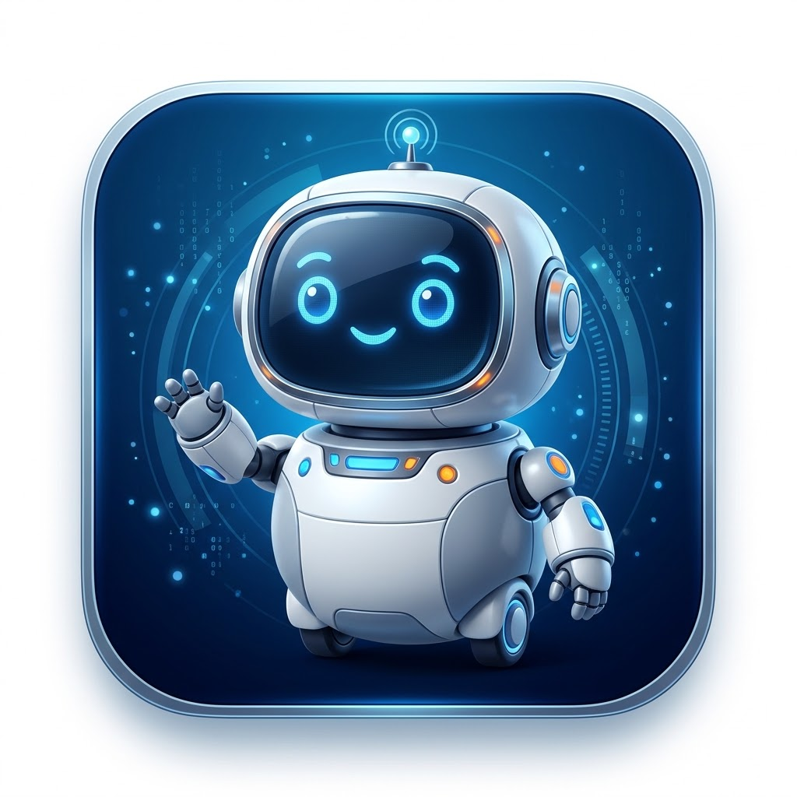
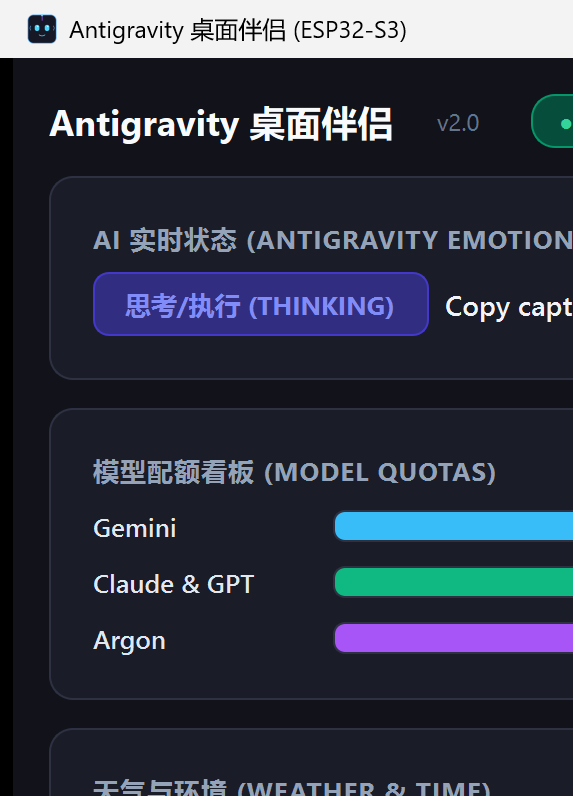
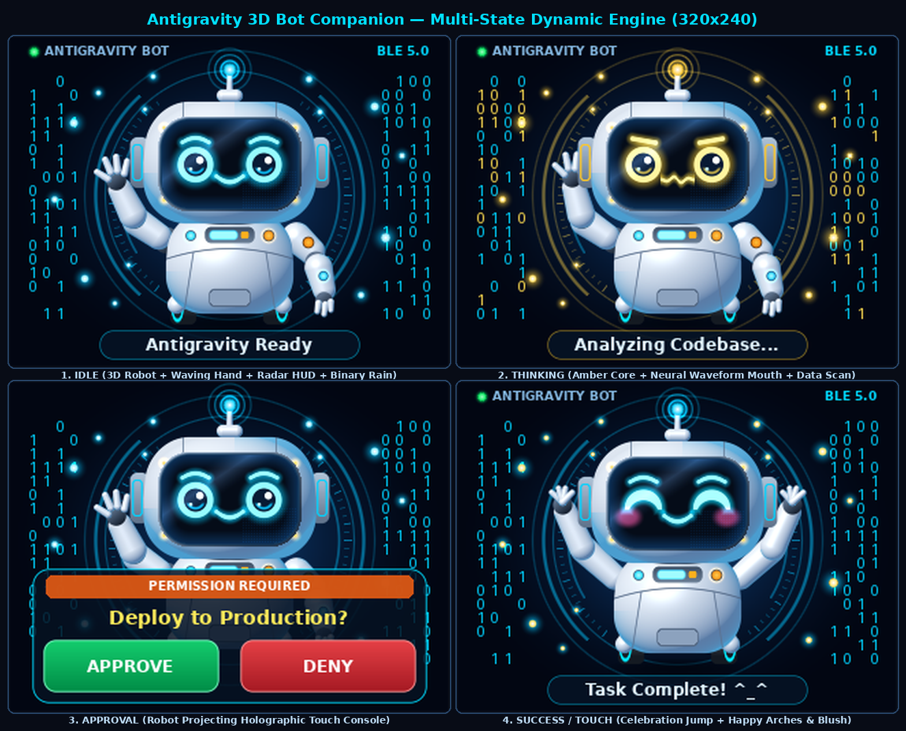

# 🤖 ESP32 Antigravity 3D Desktop Buddy (桌面赛博伴侣)

<div align="center">

[](LICENSE)
[](https://github.com/iamgyp/esp32-antgravity/releases/latest)
[](https://www.espressif.com/)
[](https://platformio.org/)
[](https://www.qt.io/)
[]()

**专为 Google Antigravity AI 编程助手打造的超低延迟硬件级桌面智能伴侣。**  
通过蓝牙 BLE 5.0 实时同步 AI 思考状态、模型配额看板、环境天气，配备 3D 渲染机器人表情与电容触控交互。

[✨ 核心功能](#-核心功能) • [📸 实机与界面展示](#-实机与界面展示) • [🚀 快速开始](#-快速开始) • [🛠️ 源码构建](#️-源码构建) • [📐 硬件规格](#-硬件规格)

</div>

---

## 📸 实机与界面展示

<div align="center">
  <h3>🖥️ 硬件实机桌面运行效果</h3>
  
</div>

<br/>

<div align="center">
  <h3>💻 Windows 桌面控制台 (PySide6 + 托盘常驻)</h3>
  
</div>

<br/>

<div align="center">
  <h3>🎭 3D 拟态机器人情绪演进</h3>
  
  <p><i>待机 (IDLE) ➔ 思考执行 (THINKING) ➔ 等待批准 (APPROVAL) ➔ 任务完成 (SUCCESS) ➔ 报错预警 (ERROR)</i></p>
</div>

---

## ✨ 核心功能

- **🎭 3D 机器人实时情感映射**：
  - 动态跟踪 Antigravity Agent 的思考与行动轨迹（读写代码、运行终端命令、网络搜索、子智能体调度）。
  - 实时反映在屏幕上的 3D 机器人表情与提示文字。
- **📊 实时模型配额看板 (Model Quota)**：
  - 精确读取当前账户的 **Gemini** (5h / weekly)、**Claude & GPT** (5h / weekly)、**Argon** 剩余额度百分比。
  - 支持屏幕滑动/触控翻页切换情绪界面与配额数据界面。
- **🌤️ 天气与温湿度监测**：
  - 自动获取城市天气状况、当前气温、全天温差区间与相对湿度。
- **⚡ 超低功耗 BLE 5.0 通信**：
  - 采用 BLE GATT 单特征数据透传，毫秒级响应，断线自动重连。
- **🖥️ 独立 Windows GUI 客户端 (`AntigravityBuddy.exe`)**：
  - **深色科幻风格**：一目了然的连接状态、实时配额进度条、通信日志与天气。
  - **后台静默常驻**：关闭主界面自动最小化到系统托盘，后台持续同步，双击托盘图标随时唤醒。
  - **防多开单实例控制**：多次双击桌面图标自动激活现有前端窗口，不抢占蓝牙信道。
  - **开机自启动管理**：内置一键开关开机启动（以托盘静默模式运行）。
- **🌙 智能自动调光与触控唤醒**：
  - 1 分钟无操作自动平滑渐变到 6% 微光待机模式，防止夜间刺眼。
  - 触摸屏幕或 Antigravity 会话产生新活动瞬间满血唤醒。

---

## 🚀 快速开始

### 方式一：开箱即用（推荐）

直接前往 [GitHub Releases](https://github.com/iamgyp/esp32-antgravity/releases/latest) 下载打包好的程序与固件：
- 📦 **[下载 Windows 客户端 (`AntigravityBuddy-Windows-x64.zip`)](https://github.com/iamgyp/esp32-antgravity/releases/download/v1.0.0/AntigravityBuddy-Windows-x64.zip)**
- ⚡ **[下载 ESP32-S3 预编译固件包 (`esp32-s3-buddy-firmware-v1.0.0.zip`)](https://github.com/iamgyp/esp32-antgravity/releases/download/v1.0.0/esp32-s3-buddy-firmware-v1.0.0.zip)**

#### 1. 烧录 ESP32-S3 固件
解压固件包后：
- **Windows 用户**：双击运行 `flash.bat`（默认 COM3，或在命令行传入指定端口：`flash.bat COM5`）。
- **Linux / macOS 用户**：
  ```bash
  chmod +x flash.sh
  ./flash.sh /dev/ttyACM0
  ```

#### 2. 运行 Windows 客户端
解压并运行 **`AntigravityBuddy.exe`**：
1. 双击运行即可打开桌面看板，自动开始扫描并连接名为 `Antigravity-Buddy` 的 ESP32 设备。
2. 勾选界面左下角的「**开机自动启动**」，下次开机将自动在后台托盘静默运行。
3. 点击右上角关闭窗口（`✕`）即自动隐藏到托盘，后台同步不中断。

---

## 🛠️ 源码构建

### 1. 固件工程编译 (PlatformIO)

```bash
cd firmware
# 编译固件
pio run -e esp32-s3-buddy

# 烧录固件及文件系统
pio run -e esp32-s3-buddy -t upload
```

### 2. Python 客户端运行 / 打包

```bash
# 安装依赖
pip install -r requirements.txt

# 直接运行 GUI 客户端
python buddy_app.py

# 使用 PyInstaller 编译为单一 exe 文件
pyinstaller --noconsole --onefile --name "AntigravityBuddy" \
    --icon "app_icon.ico" \
    --add-data "app_icon.png;." \
    --add-data "app_icon.ico;." \
    --clean buddy_app.py
```

---

## 📐 硬件规格与引脚定义

| 部件 | 规格型号 | 连接协议 / 引脚 |
| :--- | :--- | :--- |
| **主控芯片** | ESP32-S3-WROOM-1 (16MB Flash, 8MB OPI PSRAM) | - |
| **显示屏幕** | 2.8 英寸 TFT LCD (240 × 320 分辨率) | SPI (SCK: 12, MOSI: 11, CS: 10, DC: 4, RST: 48) |
| **触控芯片** | CST816D / FT6336 电容触控屏 | I2C (SDA: 8, SCL: 9, INT: 14) |
| **屏幕背光** | PWM 调光控制 (0 ~ 255) | GPIO 47 |

---

## 📁 目录结构

```
esp32-antgravity/
├── README.md                  # 项目主文档
├── LICENSE                    # 开源许可证 (MIT)
├── requirements.txt           # Python 客户端依赖
├── app_icon.ico / .png        # 应用图标
├── buddy_app.py               # Windows PySide6 图形界面客户端 + 托盘常驻
├── buddy_service.py           # 无头后台守护进程 (CLI 版)
├── get_quota.py               # WSL / Linux Antigravity 配额提取器
├── get_weather.py             # Open-Meteo 天气接口模块
├── docs/
│   └── images/                # 实机效果与 UI 截图
└── firmware/                  # ESP32 PlatformIO 固件源码
    ├── platformio.ini         # 编译配置文件
    ├── bin/                   # 预编译固件与烧录脚本
    │   ├── bootloader.bin
    │   ├── partitions.bin
    │   ├── firmware.bin
    │   ├── flash.sh
    │   └── flash.bat
    └── src/
        ├── main.cpp           # BLE GATT 服务与主循环
        ├── BuddyUI.hpp        # LovyanGFX 3D UI 引擎与看板逻辑
        └── LGFX_Config.hpp    # 屏幕驱动与引脚配置
```

---

## 📄 License

本项目基于 [MIT License](LICENSE) 开源发布。
欢迎提交 Issue 或 Pull Request！
